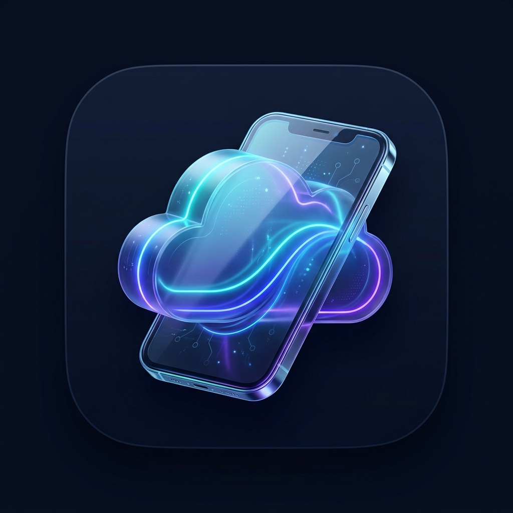

# Cloud Xtreme Pro

> **Advanced Android Virtualization, App Cloning & Cloud Phone Platform**



**Cloud Xtreme Pro** is a modern, professional Android virtualization and application isolation platform built with Kotlin and Jetpack Compose. It allows users to import Android applications and run multiple independent instances within isolated Android environments—featuring complete separation of app storage, user data, SQLite databases, SharedPreferences, cache, login sessions, and runtime lifecycles.

---

## 🚀 Key Highlights & Architectural Overview

```
                               ┌────────────────────────────────────────┐
                               │         Cloud Xtreme Pro (Host)        │
                               │        [Jetpack Compose / M3]          │
                               └──────────────────┬─────────────────────┘
                                                  │
                 ┌────────────────────────────────┼────────────────────────────────┐
                 ▼                                ▼                                ▼
   ┌───────────────────────────┐    ┌───────────────────────────┐    ┌───────────────────────────┐
   │    Local Virtualization   │    │     Cloud Phone Engine    │    │      APK & App Manager    │
   │  • VirtualFileSystem      │    │  • Remote WebRTC Stream   │    │  • Installed App Scanner  │
   │  • VirtualContext Wrapper │    │  • Interactive OS Sim     │    │  • PackageParser Service  │
   │  • DexClassLoader Sandbox │    │  • Low-Latency Touch Proto│    │  • Split APK Installer    │
   │  • VirtualProcessManager  │    │  • Free-Tier Quota Tracker│    │  • 1-Click Multi-Cloner   │
   │  • AVF / pKVM Detector    │    │  • Firebase Auth & Storage│    │  • Native .so Extractor   │
   └─────────────┬─────────────┘    └───────────────────────────┘    └───────────────────────────┘
                 │
  ┌──────────────┴──────────────┐
  │ Isolated Virtual Sandboxes  │
  ├─────────────────────────────┤
  │ Instance 1: data/db/session │ (e.g. Account A)
  │ Instance 2: data/db/session │ (e.g. Account B)
  │ Instance 3: data/db/session │ (e.g. Account C)
  │ Instance N: data/db/session │ (e.g. Account N)
  └─────────────────────────────┘
```

---

## 1. Core Virtualization Engine

Unlike simplistic app duplicators that merely copy APK binaries, **Cloud Xtreme Pro** establishes an authentic sandboxed execution container:

- **Isolated File System (`VirtualFileSystem`)**:
  - Per-instance isolated directory tree at `/data/user/0/com.cloudxtreme.pro/environments/<instance_id>/`.
  - Independent virtual subdirectories: `data/<pkg>/files/`, `data/<pkg>/databases/`, `data/<pkg>/shared_prefs/`, `data/<pkg>/cache/`, and `external/<pkg>/`.
  - Independent native `.so` library directory with ABI-matching extraction (`arm64-v8a`, `armeabi-v7a`, `x86_64`).
- **Virtual Context Interception (`VirtualContext`)**:
  - Overrides `getDataDir()`, `getFilesDir()`, `getCacheDir()`, `getDatabasePath()`, and `getSharedPreferences()`.
  - Directly isolates SQLite databases and XML preferences so multiple instances of the same application never collide.
- **Dynamic Classloading (`VirtualAppClassLoader`)**:
  - Employs `DexClassLoader` targeting the instance's isolated APK and optimized `dex_cache` directory.
- **Android Virtualization Framework (AVF) Integration (`AvfDetector`)**:
  - Automatically checks API level 33+ (Android 13/14+), `/dev/kvm` presence, `android.system.virtualmachine.VirtualMachineManager`, and hypervisor system properties (`ro.boot.hypervisor.vm.supported`).
  - Seamlessly utilizes hardware hypervisor acceleration where available and falls back to user-space process containers on standard devices.
- **Android Work Profile (`WorkProfileBridge`)**:
  - Bridges Android Enterprise managed user spaces via `DevicePolicyManager` where provisioned.

---

## 2. Cloud Phone System

Provides an optional cloud-hosted Android execution environment with full transparency:

- **Remote Screen Streaming Protocol (`RemoteStreamController`)**:
  - Low-latency WebRTC and WebSocket streaming client.
  - Real-time telemetry: FPS counter (60 FPS), RTT ping (38 ms), bitrate (Mbps), and resolution switching (720p / 1080p).
- **Interactive Cloud Android OS Simulator (`VirtualCloudAndroidOS`)**:
  - Built directly into the viewer so users can immediately interact with apps (Chrome Browser, Cloud Store, Files, Terminal Shell, Settings) even without cloud credentials.
- **Touch Gesture Protocol (`TouchInputProtocol`)**:
  - Normalizes touch coordinates (0.0 to 1.0) and translates DOWN, MOVE, UP, and CANCEL actions with multi-touch tracking.
  - Dispatches virtual system keys: Home, Back, Recent Apps, Power, and Volume.
- **Firebase & Google Cloud Integration**:
  - **Firebase Authentication (`FirebaseAuthManager`)**: User session management, anonymous logins, and secure tokens.
  - **Cloud Firestore (`FirestoreSyncService`)**: Synchronizes instance manifests, configurations, and state.
  - **Firebase Storage (`FirebaseStorageService`)**: Cloud backup snapshots and APK archival.
  - **Free-Tier Transparency (`CloudFreeTierManager`)**: Displays remaining free cloud hours (15 hrs/mo), cloud storage (20 GB), and clear pricing ($0.075/hr for dedicated GPU instances).

---

## 3. Google Play Services Support & Licensing Compliance

- **Legitimate GMS Ecosystem Integration (`GmsCompatibilityEngine`)**:
  - Detects certified Google Play Services availability on host and cloud VM nodes.
  - Supports open-source **MicroG** (`org.microg.gms.core`, `FakeStore`) compatibility stubs for isolated authentication.
  - Clearly communicates whether an environment is GMS-Certified, MicroG-Supported, or Pure Isolated AOSP.
- **Strict Compliance**:
  - **No** fraudulent device attestation tampering.
  - **No** anti-cheat evasion or security check bypasses.
  - Accurate environment reporting guaranteed.

---

## 4. Multi-Instance Management & Full Data Backup

- **Unlimited Instance Profiles**:
  - Clone any imported app into:
    - *Example App – Instance 1*
    - *Example App – Instance 2*
    - *Example App – Instance 3*
    - *Example App – Instance 4*
    - *Example App – Instance 5*
  - Each instance retains independent login credentials, data caches, and preferences.
- **Instance Actions**:
  - **Launch**: Runs the sandboxed app in `:virtual_container` process with full telemetry HUD.
  - **Stop / Pause / Resume / Restart**: Live process lifecycle control.
  - **Configure**: Fine-tune Android version, resolution, DPI, locale, timezone, RAM and storage caps.
  - **Backup & Restore (`InstanceBackupEngine`)**: Export entire sandbox state to `.cxp` (Cloud Xtreme Package / ZIP archive) and restore on demand.
  - **Delete**: Safely purge all instance sandbox storage and database files.

---

## 5. APK Manager & Split APK Installer

- **Device Application Scanner (`DeviceAppsScanner`)**:
  - Scans all installed packages via `PackageManager.getInstalledPackages`.
  - Filters out system apps or allows toggling system apps.
  - 1-click **Clone** action creates a new virtual environment instantly.
- **Storage APK Parser (`PackageParserService`)**:
  - Parses `.apk` files using Storage Access Framework (SAF).
  - Displays app icon, version name, version code, size, SDK requirements, requested permissions, and native ABIs.
- **Split APK & Architecture Support**:
  - Automatic extraction of native `.so` libraries for `arm64-v8a`, `armeabi-v7a`, `x86_64`.

---

## 6. Premium UI / UX Design

- **Cyber Dark Theme**:
  - Void Black (`#0A0E17`) & Dark Navy (`#10192A`) backgrounds.
  - Electric Blue (`#00E5FF`), Hyper Blue (`#2979FF`), Neon Purple (`#7C4DFF`), and Lavender Glow (`#B388FF`) accents.
  - Modern glassmorphism cards with glowing borders.
- **Original Application Logo**:
  - Futuristic 3D translucent cloud intertwined with a holographic smartphone outline and glowing digital nodes.
  - Included across all Android mipmap densities (`mdpi`, `hdpi`, `xhdpi`, `xxhdpi`, `xxxhdpi`) and `drawable/app_logo.png`.

---

## 📂 Project Directory Structure

```
cloud-xtreme-pro/
├── build.gradle.kts                   # Top-level Gradle build script
├── settings.gradle.kts                # Project settings & repositories
├── gradle.properties                  # JVM & AndroidX optimization flags
├── gradlew / gradlew.bat              # Gradle wrapper executable scripts
├── gradle/wrapper/
│   └── gradle-wrapper.properties      # Gradle 8.4 configuration
├── app/
│   ├── build.gradle.kts               # Module build file with Compose & Firebase
│   ├── proguard-rules.pro             # Proguard & R8 optimization rules
│   └── src/
│       ├── main/
│       │   ├── AndroidManifest.xml    # Permissions, activities & services
│       │   ├── assets/
│       │   │   └── cloud_xtreme_pro_logo.jpg
│       │   ├── res/
│       │   │   ├── drawable/          # App logo, shapes, and theme graphics
│       │   │   ├── mipmap-*/          # Launcher icons (mdpi to xxxhdpi)
│       │   │   ├── values/            # strings.xml, colors.xml, themes.xml
│       │   │   └── xml/               # file_paths.xml, data_extraction_rules.xml
│       │   └── java/com/cloudxtreme/pro/
│       │       ├── CloudXtremeApplication.kt
│       │       ├── core/
│       │       │   ├── model/         # VirtualInstance, EnvironmentConfig, etc.
│       │       │   ├── result/        # OperationResult sealed class
│       │       │   └── utils/         # FileUtils, ResourceMonitor, SecurityUtils
│       │       ├── virtualization/
│       │       │   ├── VirtualFileSystem.kt
│       │       │   ├── VirtualContext.kt
│       │       │   ├── VirtualPackageManager.kt
│       │       │   ├── VirtualAppClassLoader.kt
│       │       │   ├── VirtualProcessManager.kt
│       │       │   ├── VirtualizationEngine.kt
│       │       │   ├── VirtualContainerActivity.kt
│       │       │   ├── VirtualProcessService.kt
│       │       │   ├── avf/AvfDetector.kt
│       │       │   └── workprofile/WorkProfileBridge.kt
│       │       ├── instancemanager/
│       │       │   ├── InstanceRepository.kt
│       │       │   ├── InstanceLifecycleManager.kt
│       │       │   └── InstanceBackupEngine.kt
│       │       ├── apkmanager/
│       │       │   ├── DeviceAppsScanner.kt
│       │       │   ├── PackageParserService.kt
│       │       │   └── ApkInstallerService.kt
│       │       ├── cloud/
│       │       │   ├── TouchInputProtocol.kt
│       │       │   ├── VirtualCloudAndroidOS.kt
│       │       │   ├── RemoteStreamController.kt
│       │       │   ├── CloudFreeTierManager.kt
│       │       │   ├── CloudPhoneService.kt
│       │       │   └── firebase/
│       │       ├── gms/
│       │       │   ├── GmsCompatibilityEngine.kt
│       │       │   └── MicroGBridge.kt
│       │       ├── storage/
│       │       │   └── VirtualStorageManager.kt
│       │       └── ui/
│       │           ├── MainActivity.kt
│       │           ├── theme/         # Color, Type, Theme
│       │           ├── components/    # CyberCard, NeonButton, StatusBadge, etc.
│       │           ├── navigation/    # Screen, AppNavGraph
│       │           └── screens/
│       │               ├── dashboard/
│       │               ├── instances/
│       │               ├── cloudphone/
│       │               ├── apkmanager/
│       │               └── settings/
│       └── test/java/com/cloudxtreme/pro/
│           └── VirtualizationEngineArchitectureTest.kt
└── README.md
```

---

## 🛠️ Build and Run Instructions

### Prerequisites
- **Android Studio**: Hedgehog (2023.1.1) or Ladybug (2024.2+) recommended.
- **JDK**: Java Development Kit 17.
- **Android SDK**: Compile SDK 34 (Android 14), Min SDK 26 (Android 8.0 Oreo).

### Opening in Android Studio
1. Launch **Android Studio**.
2. Select **File > Open...** and navigate to:
   ```
   C:\Users\iamta\.gemini\antigravity\scratch\cloud-xtreme-pro
   ```
3. Allow Gradle to synchronize project dependencies.

### Command-Line Build
To build the debug APK:
```bash
# Windows
.\gradlew.bat assembleDebug

# macOS / Linux
./gradlew assembleDebug
```

The resulting APK will be generated at:
```
app/build/outputs/apk/debug/app-debug.apk
```

To run unit tests:
```bash
.\gradlew.bat testDebugUnitTest
```

---

## 🔒 Security & Privacy Guarantees

1. **Storage Isolation**: Applications running in virtual environments cannot access files, databases, or preferences of other instances or the host OS.
2. **User Data Ownership**: All instance configurations and backups are stored locally in the application sandbox.
3. **No Root Required**: Process and storage virtualization operates entirely in standard Android user space.
4. **Legitimate Execution**: The platform strictly complies with Google Play Policies and security standards.
